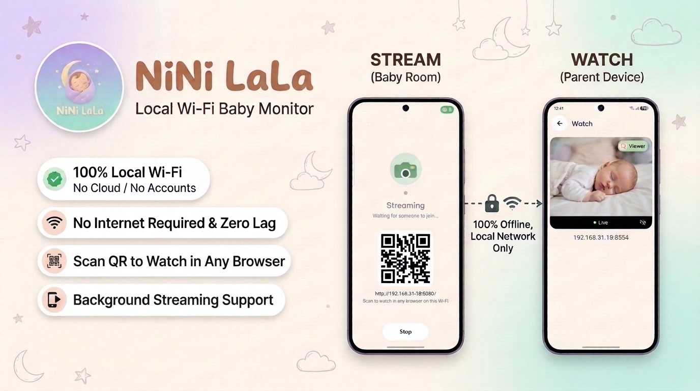

  

A baby monitor for Android on the same Wi-Fi. The video stays on your network, no account, no cloud, no internet.

## What it does

- **Phones find each other.** The camera announces itself on the local network. Watch lists whoever is streaming.
- **Live picture.** H.264 goes straight from the camera phone to the viewer.
- **A browser works too.** Start a stream, then scan the QR code from any phone or laptop on that Wi-Fi.
- **It keeps going.** Streaming runs as a foreground service, so leaving the app does not drop the camera.

Kotlin, Jetpack Compose, Camera2, and NSD.
