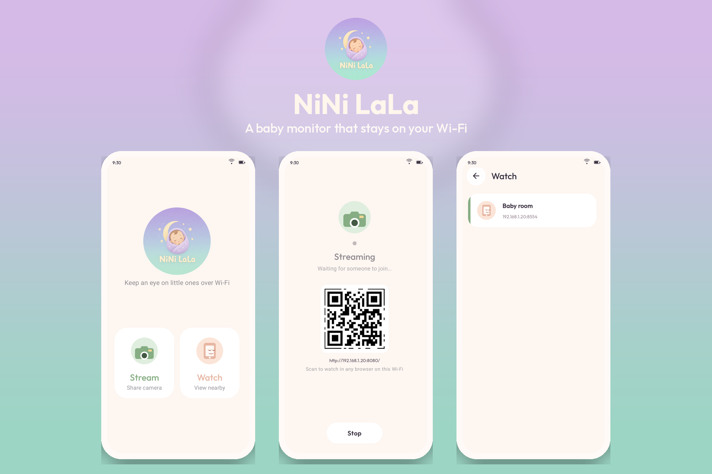

<p align="center">
  
</p>

A baby monitor for two Android phones on the same Wi-Fi. One phone shares its camera. The other watches. The video stays on your network — no account, no cloud, no internet.

## What it does

- **Phones find each other.** The camera announces itself on the local network. Watch lists whoever is streaming.
- **Live picture.** H.264 goes straight from the camera phone to the viewer.
- **A browser works too.** Start a stream, then scan the QR code from any phone or laptop on that Wi-Fi.
- **It keeps going.** Streaming runs as a foreground service, so leaving the app does not drop the camera.

## Try it

Install NiNi LaLa on two phones joined to the same Wi-Fi.

1. On the phone in the room, open **Stream** and tap **Start**.
2. On the other phone, open **Watch** and tap the room.
3. Or scan the QR code and open the stream in a browser.

Android 13 or newer.

## Build

```bash
./gradlew assembleDebug
```

The debug APK is written to `app/build/outputs/apk/debug/app-debug.apk`.

Kotlin, Jetpack Compose, Camera2, and NSD. Package name `dev.iyas.ninilala`.
